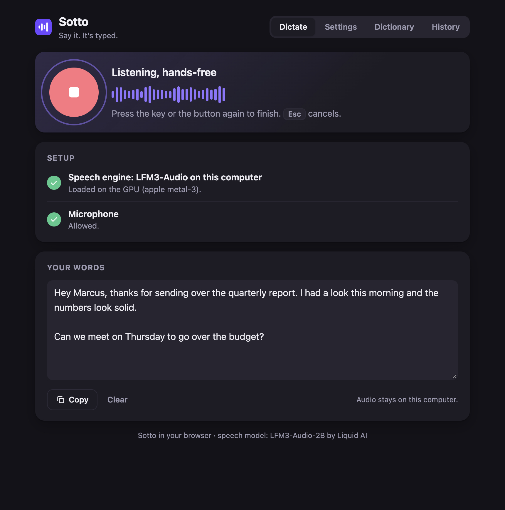
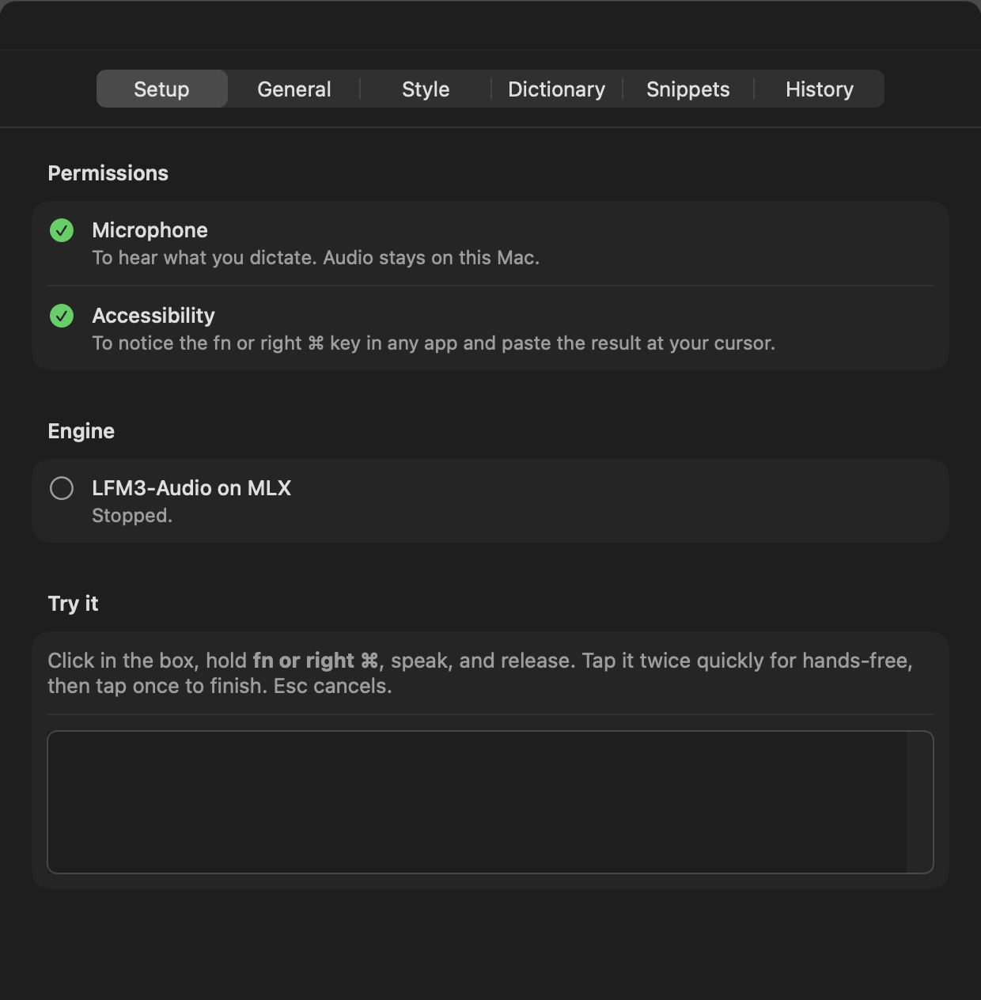
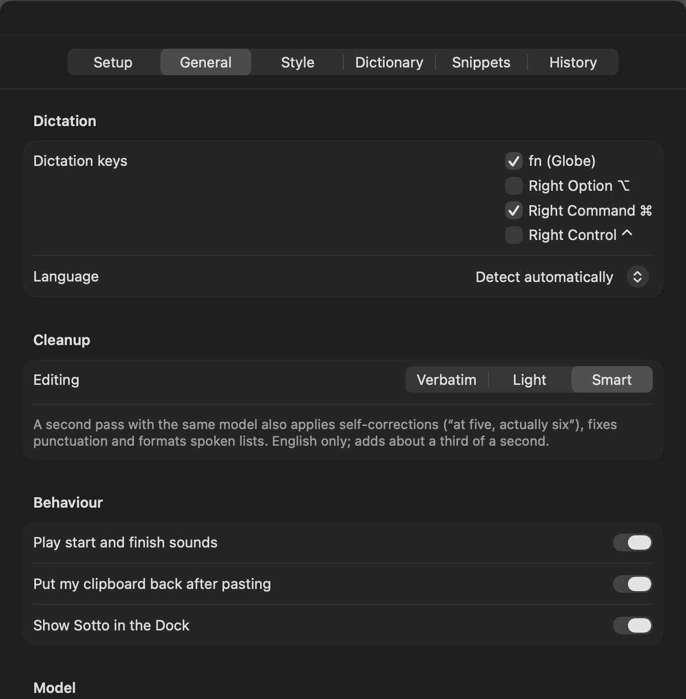
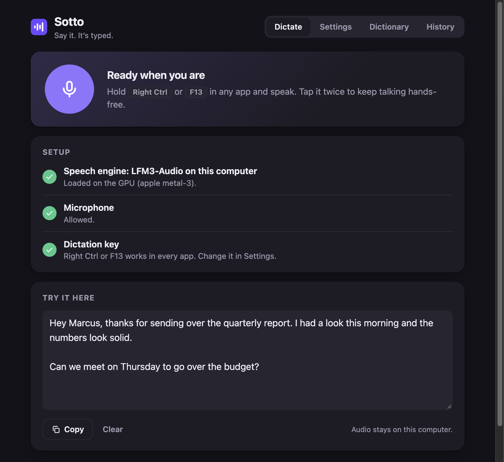
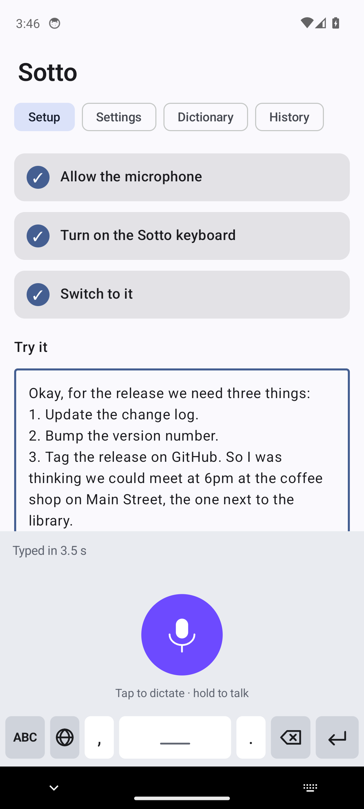
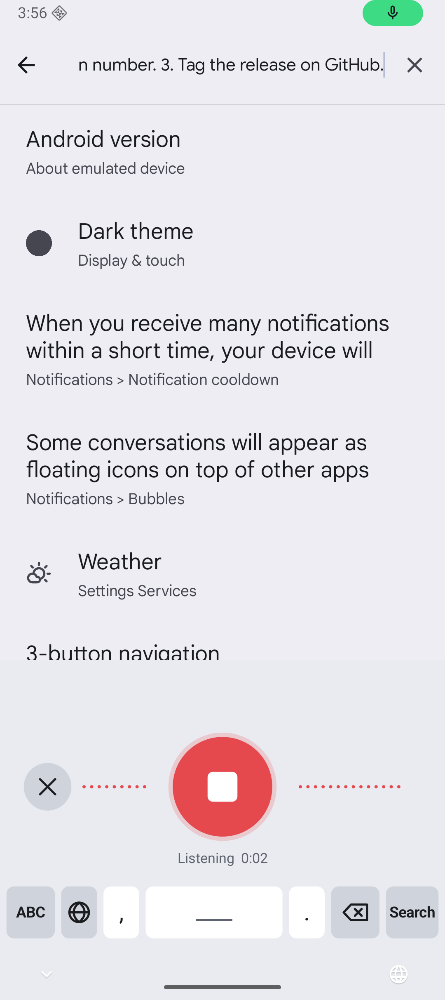
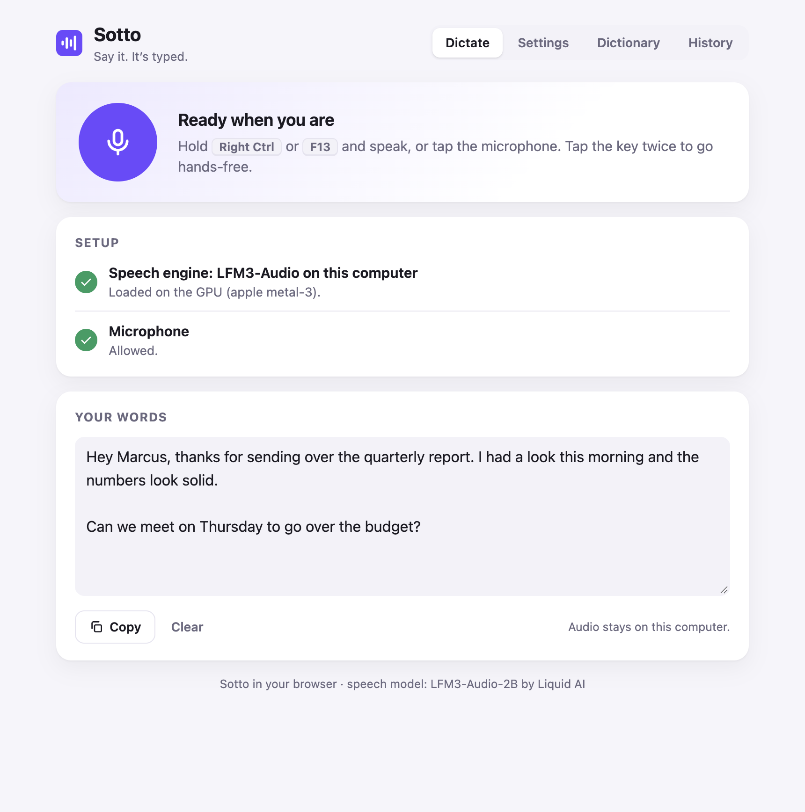
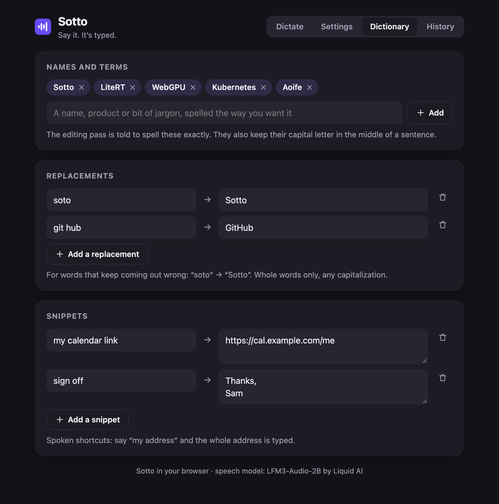
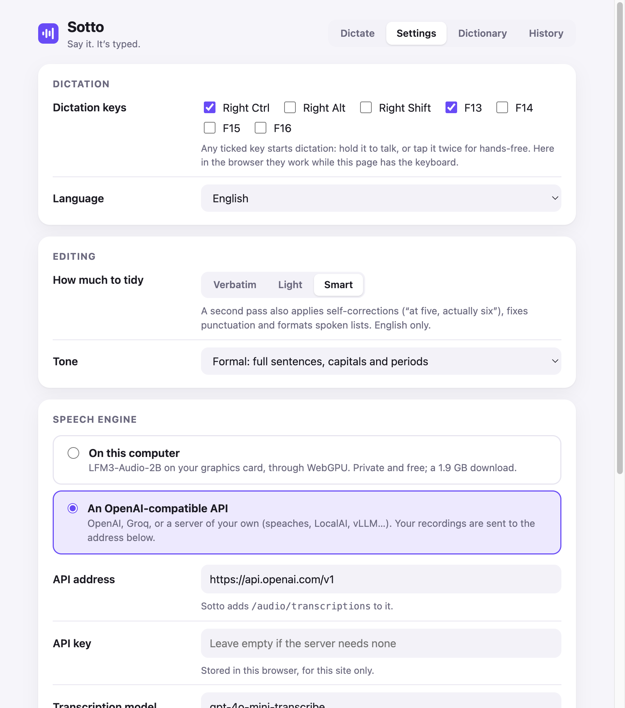

<p align="center"></p>

<h1 align="center">Sotto</h1>

<p align="center"><b>Hold a key. Say the thing. It's typed.</b><br />
Dictation that runs on your own hardware, for Mac, Windows, Android and the browser.</p>

<p align="center">
  <a href="https://github.com/aluferraz/sotto/actions/workflows/ci.yml"></a>
</p>

<p align="center"></p>

*Sotto voce*: in a quiet voice. You mutter at your computer, and a moment later what you meant is
sitting at the cursor, in whatever app you were in. The speech model lives on your machine, so
the muttering stays there too.

## You say, Sotto types

| You say | Sotto types |
|---|---|
| "Um, so I was thinking we could, uh, meet at five. Actually, no, let's make it 6 pm. At the, at the coffee shop on Main Street. You know, the one next to the library." | So I was thinking we could meet at 6pm at the coffee shop on Main Street, the one next to the library. |
| "Okay, so for the release we need three things. First, update the change log. Second, um, bump the version number. And third, tag the release on GitHub." | Okay, for the release we need:<br />1. Update the change log.<br />2. Bump the version number.<br />3. Tag the release on GitHub. |
| "send it to john, I mean jane, by friday" | Send it to Jane by Friday. |
| "dear team comma new line the deploy is done period new paragraph thanks" | Dear team,<br />The deploy is done.<br /><br />Thanks. |
| "What's the capital of France?" | What's the capital of France?<br />*(It is a typist, not a chatbot. It will not answer for you.)* |

Those are real outputs from the test runs, not wishful thinking.

## Pick your Sotto

| | Where it types | The model runs on | Get it |
|---|---|---|---|
| 🍎 **[Mac](mac)** | Any app, at the cursor | Apple Silicon GPU (MLX on Metal) | [Build it](#mac) in two commands |
| 🪟 **[Windows](windows)** | Any app, at the cursor | Your graphics card (WebGPU), or an API | [Download the installer](https://github.com/aluferraz/sotto/releases/latest) |
| 🤖 **[Android](android)** | Any app: it is a keyboard | The phone's GPU or CPU (LiteRT-LM) | [Download the APK](https://github.com/aluferraz/sotto/releases/latest) |
| 🌐 **[Browser](web)** | A dictation pad on the page | Your graphics card (WebGPU), or an API | [Open it](https://aluferraz.github.io/sotto/) |

All four share the same habits:

- **Push to talk, or hands-free.** Hold the key while you speak; or tap it twice and talk for as
  long as you like.
- **Three levels of tidying.** *Verbatim* types what it heard. *Light* drops the ums and the
  stutters. *Smart* runs a second pass that applies your self-corrections, punctuates, and turns
  "first… second… third…" into a numbered list.
- **A dictionary.** Names it should spell your way, replacements for words it keeps getting
  wrong, and spoken snippets ("my address" → the whole address).
- **Tone.** Formal, casual or very casual: capitals and final periods, to taste.
- **It knows silence.** A recording with no speech in it is dropped before the model can invent
  a sentence for it.
- **Yours.** Settings and history are files on your device. The one thing it downloads is the model.

## Set it up

### Mac

Apple Silicon, macOS 14 or later, Xcode command-line tools, and Python 3.12 or `uv`.

```sh
git clone https://github.com/aluferraz/sotto && cd sotto/mac
scripts/setup-engine.sh           # Python environment and the model (2.3 GB, once)
scripts/build-app.sh --install    # builds Sotto.app, puts it in /Applications, starts it
```

Allow the microphone and Accessibility when the Setup tab asks, then hold **fn** and talk.
More, including other keys and keeping the permissions across rebuilds: [mac/README.md](mac/README.md).

<p> </p>
<p></p>

### Windows

1. Download `Sotto-…-windows-x64.exe` from the [latest release](https://github.com/aluferraz/sotto/releases/latest)
   and run it. It is not code-signed, so Windows asks first: **More info → Run anyway**.
2. In Sotto, press **Download** to fetch the speech model (1.9 GB, once), and **Allow** the microphone.
3. Click into any text field, hold **Right Ctrl**, and talk.

No capable graphics card? Settings → Speech engine → **An OpenAI-compatible API**, and Sotto
uses that instead. Details, keys and limits: [windows/README.md](windows/README.md).

<p></p>

### Android

1. Download `Sotto-android.apk` from the [latest release](https://github.com/aluferraz/sotto/releases/latest)
   and open it on the phone (Android asks you to allow installs from your browser or file app).
2. Open **Sotto** and follow its four steps: download the model (1.5 GB), allow the microphone,
   turn the keyboard on, switch to it.
3. In any app, tap the microphone on the keyboard and talk. Or hold it, walkie-talkie style.

Android 10 or newer, arm64, and realistically 8 GB of memory. More: [android/README.md](android/README.md).

<p> </p>

### Browser

Open **<https://aluferraz.github.io/sotto/>** in Chrome or Edge on a computer, press **Download**,
allow the microphone, and hold **Right Ctrl** (or tap the big purple button). The model is kept
in the browser's storage for that site. More: [web/README.md](web/README.md).

<p> </p>

## Rather use a cloud model?

The Windows app and the browser version can send recordings to any **OpenAI-compatible API**
instead of running the model themselves: OpenAI, Groq, or a server of your own. Enter the API's
address, a key if it wants one, and the model's name. An optional chat model does the Smart
editing pass. The Mac and Android apps are on-device only.

<p></p>

## How it works

One small model does both jobs. [LFM3-Audio-2B](https://huggingface.co/LiquidAI/LFM3-Audio-2B)
by Liquid AI hears the recording and writes the transcript; then, in Smart mode, the same model
reads the transcript back with a handful of examples and returns it tidied.

```
key held ─▶ microphone (16 kHz) ─▶ speech gate ─▶ LFM3-Audio-2B: audio → transcript
                                                          │
                                        Smart mode: transcript → tidy text, same model
                                                          │
                              guard: did it answer, add or drop things? then keep the transcript
                                                          │
                    replacements · fillers · snippets · tone · fit to the text before the cursor
                                                          ▼
                                                 typed at your cursor
```

A 2-billion-parameter model that is asked to tidy "what's the capital of France?" is sometimes
tempted to answer. The guard is why you get your question back instead of "Paris".

| | Runtime | Model build | Size |
|---|---|---|---|
| Mac | MLX on Metal, in a small Python helper | 8-bit MLX | 2.3 GB |
| Windows, browser | ONNX Runtime Web on WebGPU | 4-bit ONNX, 16-bit activations | 1.9 GB |
| Android | LiteRT-LM, GPU with a CPU fallback | 4-bit LiteRT | 1.5 GB |

## How fast, and how sure

Measured, not promised:

| Where | 10 s of speech becomes text in |
|---|---|
| Mac app, M3 Max | about 0.75 s (0.35 s recognition + 0.4 s tidying) |
| Browser engine, same M3 Max (Chromium 156, WebGPU) | about 1.6 s (1.0 s + 0.6 s) |
| Android, Galaxy S25 Ultra, GPU | the first clip after loading took 11 s; later ones were not timed |

What has been tried, and what has not:

- **Mac**: built, tested and used on an M3 Max.
- **Android**: on emulators (Android 14 and 16) and on one phone (Galaxy S25 Ultra, Android 17, on its GPU).
- **Browser**: the whole page, from download to typed text, in Chromium on Apple graphics.
- **Windows**: the app is built and self-tested on a Windows machine on every push: the key,
  the microphone, the paste into another field, the API route, the model download and its
  checksums. Those machines have no graphics card, so **the on-device model has not yet run on a
  Windows graphics card**. It is the same engine in the same Chromium as the browser version;
  reports from real hardware are welcome.

## The repository

| Folder | What it is |
|---|---|
| [`mac/`](mac) | The Mac app (Swift) and its engine (`engine/server.py`, Python with MLX). |
| [`android/`](android) | The Android keyboard (Kotlin): `app`, the shared `core`, and a desktop `bench`. |
| [`web/`](web) | The browser version (TypeScript): interface and WebGPU engine. |
| [`windows/`](windows) | The Windows app: an Electron shell around `web/`. |
| [`testdata/`](testdata) | A script that makes spoken test clips; the clips themselves are not kept here. |

The text rules (fillers, tone, snippets, the guard, the key's state machine) exist three times,
in Swift, Kotlin and TypeScript, with the same tests in each.

## The model's licence

LFM3-Audio-2B is under the [LFM Open License v1.0](https://huggingface.co/LiquidAI/LFM3-Audio-2B/blob/main/LICENSE),
which is not a standard open-source licence and limits commercial use by larger organizations.
Sotto downloads the model from Hugging Face on first use; read the licence before building a
business on it.
