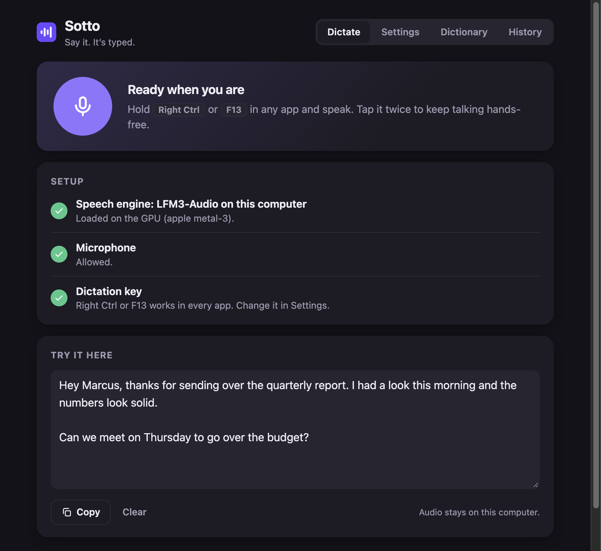

# Sotto for Windows

Hold **Right Ctrl**, speak, release: the text is typed where your cursor is, in any app. Sotto
sits in the tray; a small indicator at the bottom of the screen shows when it is listening.

The speech model runs on your own graphics card, through WebGPU. Or point Sotto at any
OpenAI-compatible API and it uses that instead.



## Install

1. Download `Sotto-…-windows-x64.exe` from the [latest release](https://github.com/aluferraz/sotto/releases/latest)
   and run it. The installer is not code-signed, so Windows shows "Windows protected your PC":
   choose **More info → Run anyway**. (The `.zip` next to it is the same app without an installer.)
2. Sotto opens. Under **Setup**, press **Download** to fetch the speech model (1.9 GB, once), or
   choose an API in Settings (below).
3. Press **Allow** next to Microphone. If Windows blocks it, turn on *Settings → Privacy &
   security → Microphone → Let desktop apps access your microphone*.
4. Click into any text field, hold **Right Ctrl** and talk.

It needs 64-bit Windows 10 or 11. For the on-device model: a graphics card with current drivers
and about 2 GB of free graphics memory (integrated graphics of the last several years count),
plus 2 GB of disk space. Without one, use an API.

## Use

| | |
|---|---|
| Hold the key, speak, release | Dictate (push to talk) |
| Tap the key twice quickly | Hands-free: keeps listening until you press it once more |
| Esc | Cancel, while recording or while the text is being written |
| Tray icon | Open Sotto, settings, history, copy the last dictation, quit |

Settings:

- **Dictation keys**: Right Ctrl, Right Alt, Right Shift, or F13 to F16, in any combination. F13
  to F16 are there for keyboards with macro keys: map a macro key to F13 in the keyboard's own
  software and tick F13 here.
- **Microphone**: the system's default, or any connected one by name.
- **Language**: 18 languages, or automatic.
- **Editing**: *Verbatim*, *Light* (drops um/uh and stutters) or *Smart* (a second pass that
  applies self-corrections, fixes punctuation and formats spoken lists; English only).
- **Tone**: Formal, Casual or Very casual. It only changes capitals and the final period.
- **Dictionary**: names to spell exactly, replacements for words that keep coming out wrong, and
  spoken snippets ("my address").
- **History**: kept on this computer; can be switched off.

While Sotto listens, and until the text is typed, the computer and its screen are kept awake.

Closing the window leaves Sotto running in the tray. *Start Sotto when I sign in* is in Settings.

## Using an API instead of the local model

Settings → Speech engine → **An OpenAI-compatible API**. Sotto then sends each recording as a WAV
file to `{API address}/audio/transcriptions`, the endpoint OpenAI defined and many services and
self-hosted servers copy.

| Field | What to enter |
|---|---|
| API address | The API's root, ending in `/v1` for most services: `https://api.openai.com/v1`, `https://api.groq.com/openai/v1`, or your own server such as `http://localhost:8000/v1` |
| API key | The service's key. Leave it empty for a local server that needs none. It is stored encrypted with your Windows account. |
| Transcription model | The model's name at that service, for example `gpt-4o-mini-transcribe` or `whisper-1` at OpenAI, `whisper-large-v3-turbo` at Groq. Their lists change; check the service's own page. |
| Editing model | Optional. A chat model at the same address for the Smart pass (`/chat/completions`). Left empty, Smart behaves like Light. |

Your dictionary is passed along as the API's spelling hint. The same guard as with the local
model applies: if the editing model answers your sentence instead of tidying it, Sotto types
what you said.

## Limits

- The text is pasted through the clipboard (Ctrl+V), and the clipboard's previous content is
  put back afterwards.
- Windows does not let an ordinary app type into a program that runs as administrator. To
  dictate into one, start Sotto as administrator too.
- On keyboard layouts with AltGr, the Right Alt key is AltGr; prefer Right Ctrl there.
- One tone for all apps: the per-app tone of the Mac version is not here yet.
- Text arrives when you stop speaking, not while you speak. Recordings stop at 5 minutes.

## How it is built

The window shows the [web app](../web), which contains the whole interface and the speech engine
(ONNX Runtime Web on WebGPU, in Chromium). This folder is the shell around it (Electron):

| File | What it does |
|---|---|
| `src/main.ts` | Serves the web app to its window, hears the dictation key in every app (`uiohook-napi`), pastes into the app in front, keeps the tray icon and the floating indicator, stores the API key with Windows' own encryption, and makes the API requests. |
| `src/preload.ts` | The handful of functions the page is allowed to call. |
| `src/smoke.ts` | The self-test described below. |

```sh
npm --prefix ../web install && npm --prefix ../web run build
npm install
npm start                                  # run it (works on a Mac too, for development)
npx electron-builder --win --x64           # the installer and the zip, into release/
```

## How it is tested

Every push builds the app on a Windows machine at GitHub and runs its self-test there
(`--smoke-test`): it presses the dictation key through the operating system, speaks a clip made
with the Windows voice through a fake microphone, answers the transcription request from a
stand-in API on the same machine, and reads back what was pasted into a text field. It also
downloads the real model from Hugging Face into the app's storage and checks every file.

What that cannot cover: those machines have no graphics card, so **the on-device model has not
yet been run on a Windows graphics card**. The same engine in the same Chromium runs on Apple
graphics (see the [web README](../web/README.md)); if it misbehaves on yours, the Setup screen
says why, and an issue with that message would be welcome.
